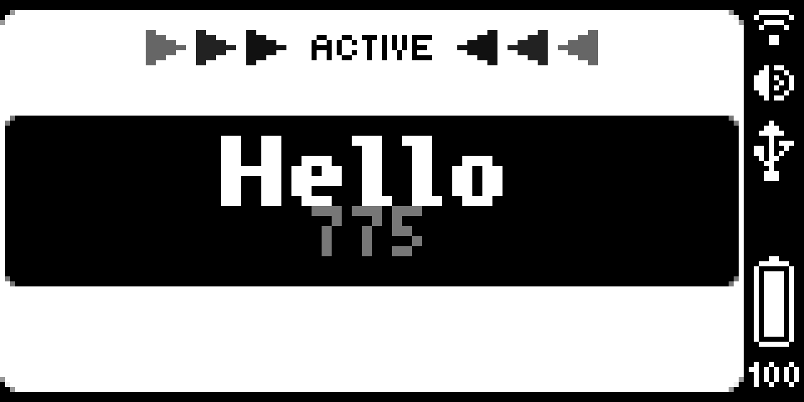

<!-- Made by BUSY Bar Emulator from catalog.json. Edit it freely: once you change it, it is yours and is not made again. -->

# Disco Elysium

aregergwethgqegqergq3rg3qrg3r3g3rg3rg3rg3rg3rg3rg3rg




## How to use

фв

## Build and install

```sh
npm ci
npm run build         # dist/app.mrlunev.disco_elysium.tgz
npm run app:install   # on a BUSY Bar connected over USB
```

Or open the folder in BUSY Bar Emulator and press Refresh.

## Licence

MIT: see [LICENSE](LICENSE).

Made for [BUSY Bar](https://busy.app).
